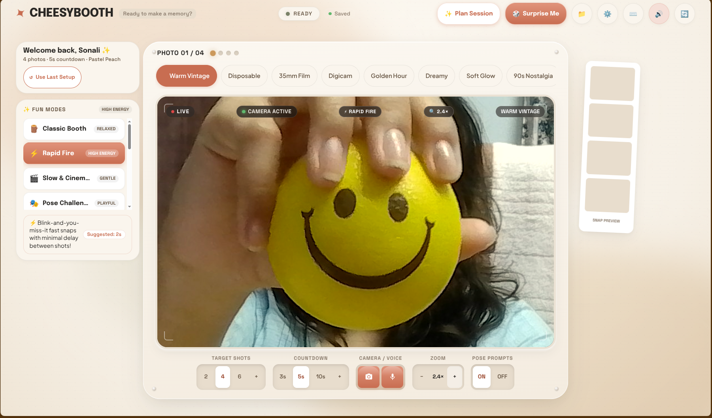
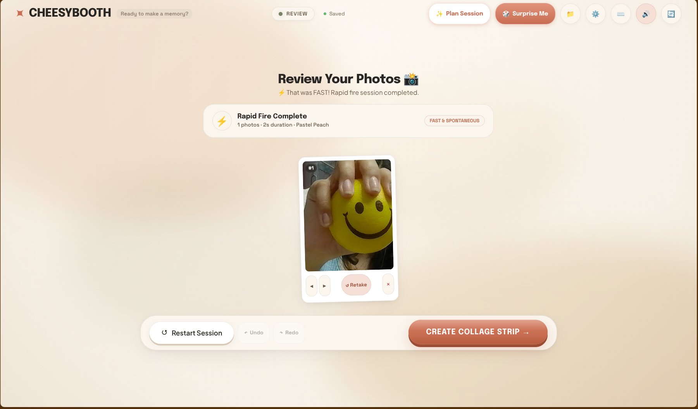
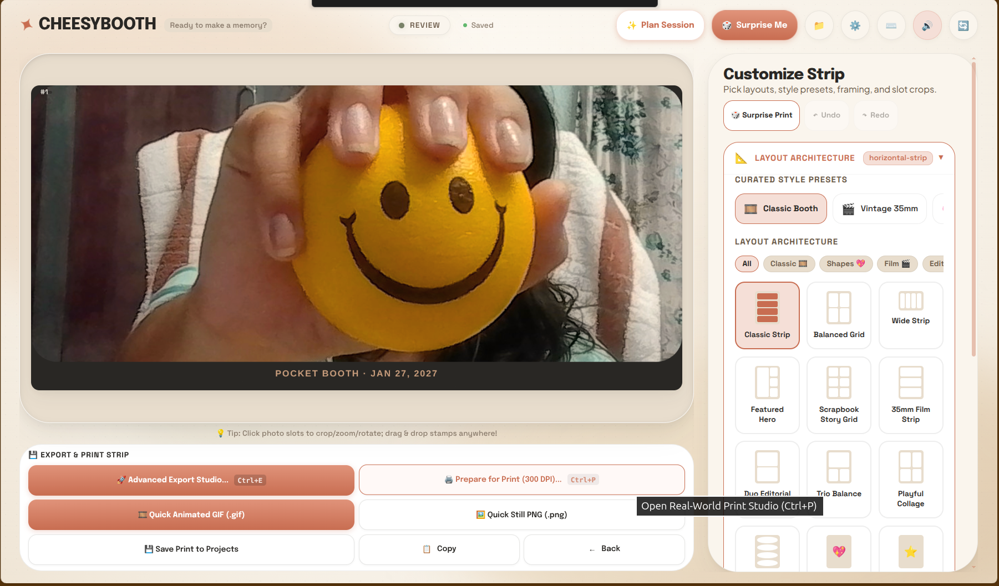
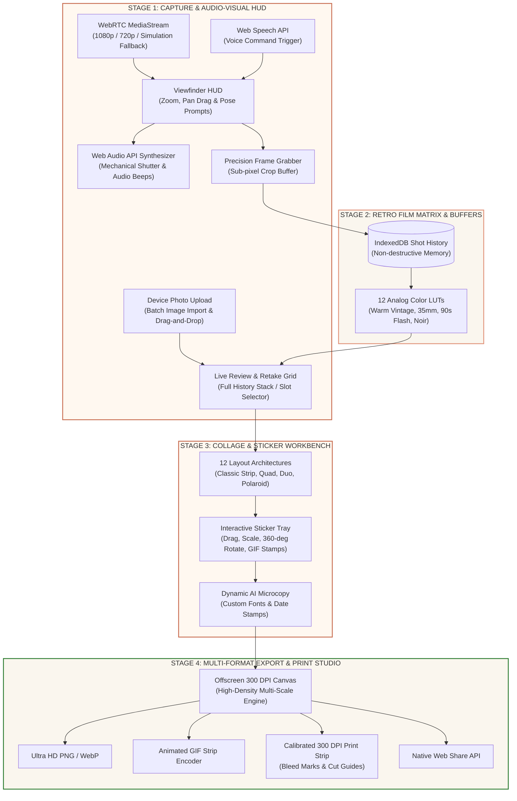
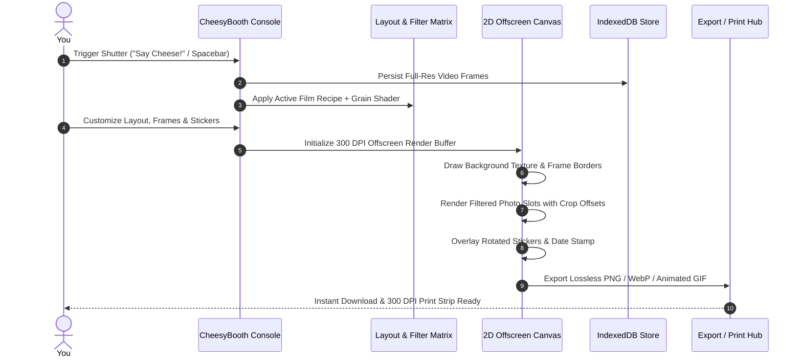
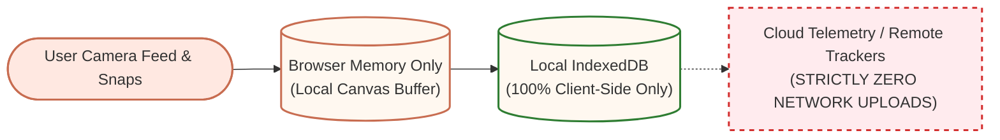

# CheesyBooth - *The Tactile & Aesthetic Digital Photobooth*

<div align="center">

<pre style="font-family: monospace; font-size: 11px; line-height: 1.2; background: #FAF6EE; color: #2D2B28; padding: 16px 12px; border-radius: 14px; border: 1.5px solid #E6DAC8; display: inline-block; text-align: left; overflow-x: auto; max-width: 100%;">
<span style="color: #C86D51;">   ██████╗██╗  ██╗███████╗███████╗███████╗██╗   ██╗</span><span style="color: #2D2B28;">██████╗  ██████╗  ██████╗ ████████╗██╗  ██╗</span>
<span style="color: #C86D51;">  ██╔════╝██║  ██║██╔════╝██╔════╝██╔════╝╚██╗ ██╔╝</span><span style="color: #2D2B28;">██╔══██╗██╔═══██╗██╔═══██╗╚══██╔══╝██║  ██║</span>
<span style="color: #C86D51;">  ██║     ███████║█████╗  █████╗  ███████╗ ╚████╔╝ </span><span style="color: #2D2B28;">██████╔╝██║   ██║██║   ██║   ██║   ███████║</span>
<span style="color: #C86D51;">  ██║     ██╔══██║██╔══╝  ██╔══╝  ╚════██║  ╚██╔╝  </span><span style="color: #2D2B28;">██╔══██╗██║   ██║██║   ██║   ██║   ██╔══██║</span>
<span style="color: #C86D51;">  ╚██████╗██║  ██║███████╗███████╗███████║   ██║   </span><span style="color: #2D2B28;">██████╔╝╚██████╔╝╚██████╔╝   ██║   ██║  ██║</span>
<span style="color: #C86D51;">   ╚═════╝╚═╝  ╚═╝╚══════╝╚══════╝╚══════╝   ╚═╝   </span><span style="color: #2D2B28;">╚═════╝  ╚═════╝  ╚═════╝    ╚═╝   ╚═╝  ╚═╝</span>
</pre>

<p align="center">
  <b><i>"Say Cheese, Look Gorgeous, Keep Memories Forever."</i></b><br/>
  <i>A buttery-smooth, local-first vintage analog photobooth crafted with pure Vanilla web technologies.</i>
</p>

<!-- Tech Stack Badges -->
<p align="center">
  
  
  
  
  
  
  
  
  
  
  
</p>

<p align="center">
  <a href="#the-cheesy-experience">The Experience</a> •
  <a href="#visual-showcase">Visual Showcase</a> •
  <a href="#system-architecture">Architecture</a> •
  <a href="#spicy-features">Features</a> •
  <a href="#canvas--export-pipeline">Canvas Pipeline</a> •
  <a href="#zero-telemetry-privacy">100% Privacy</a> •
  <a href="#quick-start">Quick Start</a> •
  <a href="#keyboard-shortcuts">Shortcuts</a>
</p>

</div>

---

## The Cheesy Experience

**CheesyBooth** resurrects the timeless, electric charm of Japanese Purikura booths and 1970s Parisian photomatons directly in modern web browsers.

Built with **100% Vanilla Web Standards** (HTML5, Modern CSS Design Tokens, and JavaScript ES6+), it delivers a velvety 60 FPS studio interface with zero build lag, zero third-party dependencies, and zero cloud tracking.

---

## Visual Showcase

<div align="center">
  
  <br/><br/>
  
  <br/><br/>
  
</div>

```
       .────────────────────────────────────────────────────────────.
      /   ✦  C H E E S Y B O O T H  ·  A E S T H E T I C  v 1 . 0  ✦  \
     |    ────────────────────────────────────────────────────────    |
     |   |                                                        |   |
     |   |    [LIVE]     [1080p HD]     [WARM VINTAGE]    [60 FPS]    |   |
     |   |                                                        |   |
     |   |                     [ S A Y  C H E E S E ! ]           |   |
     |   |                                                        |   |
     |   |________________________________________________________|   |
     |                                                                |
     |    [ 2 SHOTS ] [ 4 SHOTS ] [ 6 SHOTS ]    ( CAMERA ) ( VOICE ) |
     |    [ 3s TIMER ] [ 5s TIMER ] [ ZOOM ]     [ UPLOAD ] [ POSE ]  |
      \──────────────────────────────────────────────────────────────/
```

---

## System Architecture



---

## Spicy Features

### 1. Studio Camera, Optical Zoom & Voice Control
- **Fluid WebRTC Engine:** Automatic HD resolution negotiation (1080p $\to$ 720p $\to$ 480p) with seamless simulation fallback.
- **Live Optical Zoom & Pan Focus:** Smooth 1.0× to 3.0× zoom with interactive screen drag-to-pan, pinch-to-zoom, mouse wheel zoom, and double-click recenter.
- **Direct Photo Upload:** Batch import pre-clicked photos from your device (`📁 Upload`) or drag & drop images directly onto the viewfinder.
- **Voice-Activated Snap:** Hands-free shooting with continuous speech recognition (*"Cheese!"*, *"Shoot!"*, *"Snap!"*).
- **Tactile Pacing Modes:** 12 curated session modes (*Classic*, *Rapid Fire*, *Cinematic*, *Pose Challenge*, *Chaos Timer*, *Mystery Pose*).
- **Spatial Audio Synthesizer:** Real-time dual-oscillator acoustic shutter, mechanical windup, countdown chimes, and retro clicks.

### 2. 12 Artisanal Film Emulations
| Filter Preset | Character & Mood | Tone Matrix |
| :--- | :--- | :--- |
| **Warm Vintage** | Golden hour glow, lifted amber shadows | `#E0937A` & `#DDA15E` warm tones |
| **35mm Analog** | Heavy grain, lush greens, rich contrast | Cinematic film curve |
| **Disposable 90s** | Direct flash pop, cool cyan shift | High key nostalgic saturation |
| **Cyber 2000s** | Ultra-vibrant Y2K digicam gloss | Saturated neon highlights |
| **Sunset Mirage** | Luminous rose gold & twilight hues | Gradient color grading |
| **Faded Noir** | Velvety monochrome with silver mids | True gelatin silver B&W |

### 3. Dynamic Collage Studio & Sticker Lab
- **14 Geometry Architectures:** 2-shot duos, 3-shot classic vertical strips, 4-shot polaroid quads, 6-shot cinematic contact sheets, Arch Gallery domes, heart mosaic, and wide scrapbooks.
- **Unified Workspace Zoom & Pan:** Trackpad pinch, <kbd>Ctrl</kbd>+Wheel, or 2-finger touch to scale the entire collage as a single container (0.35× to 3.5×) with smooth canvas panning and double-click reset.
- **Sub-Pixel Photo Slot Inspector:** Click any photo slot (top, bottom, or edges) to crop, zoom, pan X/Y, rotate, flip, swap frames, or customize cutout shapes (Arch, Circle, Ellipse, Rounded, Rectangle).
- **Proportional Coordinate Overlay System:** 100% accurate responsive selection boxes that stay locked to the canvas across all device resolutions, browser scales, and zoom levels.
- **Interactive Sticker Engine:** 100+ curated stickers, dynamic GIF stamps, custom image uploads, and smooth 360° transform handles.
- **Bespoke Typography:** Retro date stamps, handwritten labels, and customizable caption prompts.

### 4. Physical 300 DPI Print Ready
- **Real-World Calibration:** Standard 2×6″ photobooth strips, 4×6″ postcards, and 5×7″ scrapbook prints.
- **Print Perfection:** CSS `@media print` layout with built-in cut guides, bleed margins, and CMYK contrast tuning.

---

## Canvas & Export Pipeline



---

## Zero-Telemetry Privacy



> [!IMPORTANT]
> **CheesyBooth is 100% Local-First.**
> Your photos, facial previews, edits, and voice triggers never touch a remote server. Everything is processed directly inside your browser sandbox.

---

## Quick Start

CheesyBooth has **zero build steps** and **zero dependencies**. Just clone and serve:

### Option 1: Python Built-in Server (Recommended)
```bash
python3 -m http.server 3000
```
Open **`http://localhost:3000`** in your browser.

### Option 2: Node Static Server
```bash
npx serve -l 3000 .
```

### Option 3: VS Code / Live Server
Right-click `index.html` and click **"Open with Live Server"**.

---

## Master QA & Automated Test Suite

CheesyBooth is validated against **15 automated regression and unit test suites**:

```bash
node scratch/test_production_suite.js
```

```
================================================================
   CHEESYBOOTH - MASTER PRODUCTION QA & TEST SUITE
================================================================

 [OK] test_security............................ PASSED
 [OK] test_ai.................................. PASSED
 [OK] test_themes.............................. PASSED
 [OK] test_statistics.......................... PASSED
 [OK] test_easter_eggs......................... PASSED
 [OK] test_compatibility_and_microinteractions.. PASSED
 [OK] test_export.............................. PASSED
 [OK] test_errors.............................. PASSED
 [OK] test_performance......................... PASSED
 [OK] test_privacy............................. PASSED
 [OK] test_recovery............................ PASSED
 [OK] test_randomizer.......................... PASSED
 [OK] test_keyboard_a11y....................... PASSED
 [OK] test_mobile.............................. PASSED
 [OK] test_ux_refinements...................... PASSED

================================================================
   QA SUITE RESULTS: 15/15 Test Suites Passed (100%)
================================================================
```

---

## Keyboard Shortcuts

| Shortcut / Gesture | Action |
| :--- | :--- |
| <kbd>Space</kbd> / <kbd>Enter</kbd> | Take Photo / Trigger Countdown |
| <kbd>+</kbd> / <kbd>-</kbd> | Live Camera Zoom In / Out |
| Trackpad Pinch / <kbd>Ctrl</kbd>+Wheel | Smooth Whole-Collage Workspace Zoom |
| Background Drag / Middle Click | Pan Zoomed Collage Workspace |
| Double Click Workspace Background | Reset Collage Zoom & Pan to 1.0× |
| Click Photo Slot | Select Slot & Open Photo Slot Inspector |
| <kbd>Ctrl</kbd> + <kbd>E</kbd> | Open Studio Export Hub |
| <kbd>Ctrl</kbd> + <kbd>P</kbd> | Launch 300 DPI Print Studio |
| <kbd>Ctrl</kbd> + <kbd>Z</kbd> | Undo Last Action |
| <kbd>Ctrl</kbd> + <kbd>Shift</kbd> + <kbd>Z</kbd> | Redo Action |
| <kbd>1</kbd> – <kbd>9</kbd> | Switch Film Presets Instantly |
| <kbd>V</kbd> | Toggle Hands-Free Voice Control |
| <kbd>?</kbd> | Open Shortcuts Cheat Sheet |

---

## Tech Tags & Ecosystem

<div align="center">

`#HTML5` • `#CSS3` • `#VanillaJS` • `#WebRTC` • `#Canvas2D` • `#WebAudioAPI` • `#WebSpeechAPI` • `#IndexedDB` • `#PWA` • `#LocalFirst` • `#ZeroDependencies` • `#60FPS` • `#Photobooth` • `#AestheticUI`

<br/>

Crafted with warm nostalgia and code artistry  
**CheesyBooth · 2026**

</div>
